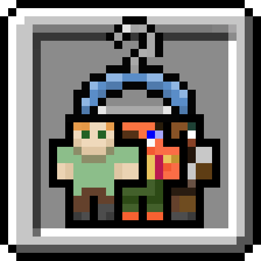

<!-- PROJECT BADGES -->

![Version][version-badge]
[![Stars][stars-badge]][stars-url]
[![License][license-badge]][license-url]

<!-- PROJECT LOGO -->
 

  
  <h3>PersonaSkin</h3>
  

    An plugin that shows persona skins made with the Character Creator correctly!

[Contact to me][author-discord] · [Report a bug][issues-url] · [Request a feature][issues-url]

  

<!-- ABOUT THE PROJECT -->

## About The Project

![Project Preview][project-preview]
  ✔️ Support for persona skin (it created via character creators)!
  ✔️ Now you don't have to see a skin filled with random colors!

#### :question: What is a **persona skin**?

**Persona skin** is a new format of skin created via the [**character creator
**](https://minecraft.gamepedia.com/Character_creator)  
It was added
in [Bedrock_Edition_1.13.0](https://minecraft.gamepedia.com/Bedrock_Edition_1.13.0) [(released on October 29, 2019)](https://feedback.minecraft.net/hc/en-us/articles/360035247792)

- Vanilla PocketMine-MP does not support this skin format, and makes it show as a skin filled with random colors.

##

-----

## Installation & Requirements

- **Server**
  - [axolotl-pm/PocketMine-MP](https://github.com/axolotl-pm/PocketMine-MP) `5.51` or higher (`plugin.yml` `api: [5.51.0]`),
    which uses BedrockProtocol 64 (Bedrock `1.26.60`).
  - PHP `8.4` or higher.
- **Installation**
  1) Download `PersonaSkin.phar` from [GitHub Releases][releases-url]
  2) Move the downloaded `.phar` file to the server's **/plugins/** folder
  3) Restart the server
- **Old versions**
  - The version for the original [pmmp/PocketMine-MP](https://github.com/pmmp/PocketMine-MP) `5.x` is kept on
    the [`legacy/pmmp-5.44`](https://github.com/presentkim-pm/PersonaSkin/tree/legacy/pmmp-5.44) branch.
- **Development**
  - `composer install` then `composer test` runs the PHPUnit tests.
- **How it works**
  - On enable the plugin replaces the server's `SkinAdapter` with `PersonaSkinAdapter`, which remembers the original
    `SkinData` of persona skins and sends it to other players, instead of the random-colored placeholder skin.
    On disable the original adapter is restored.

##

-----

## License

Distributed under the **LGPL 3.0**. See [LICENSE][license-url] for more information

##

-----

[author-discord]: https://discordapp.com/users/345772340279508993

[version-badge]: https://img.shields.io/github/v/release/presentkim-pm/PersonaSkin?display_name=tag&style=for-the-badge&label=VERSION

[release-badge]: https://img.shields.io/github/downloads/presentkim-pm/PersonaSkin/total?style=for-the-badge&label=GITHUB%20

[stars-badge]: https://img.shields.io/github/stars/presentkim-pm/PersonaSkin.svg?style=for-the-badge

[license-badge]: https://img.shields.io/github/license/presentkim-pm/PersonaSkin.svg?style=for-the-badge

[stars-url]: https://github.com/presentkim-pm/PersonaSkin/stargazers

[releases-url]: https://github.com/presentkim-pm/PersonaSkin/releases

[issues-url]: https://github.com/presentkim-pm/PersonaSkin/issues

[license-url]: https://github.com/presentkim-pm/PersonaSkin/blob/main/LICENSE

[project-icon]: https://raw.githubusercontent.com/presentkim-pm/PersonaSkin/main/assets/icon.png

[project-preview]: https://raw.githubusercontent.com/presentkim-pm/PersonaSkin/main/assets/preview.gif
